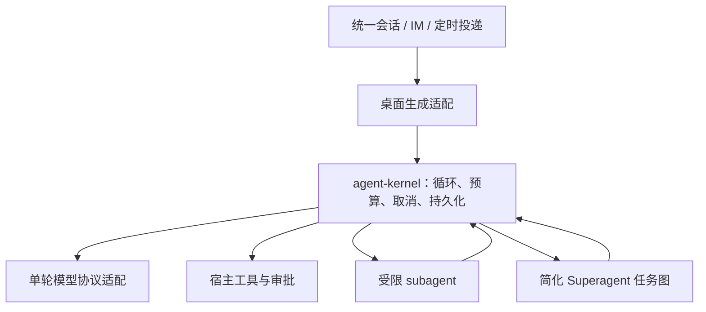

# RikkaHub Desktop PLUS 0.2.0

本目录是独立 Alpha 源码，原 `rikkahub-desktop-plus/` 未作为修改目标。重构前的源码（包括原有未提交修改）和退役的 pi 集成均另有 ZIP 备份。Alpha 使用独立数据目录，不要求迁移原有个人数据。

## 使用

解压便携测试包后双击 **`Demo.cmd`**。它通过原生 WinForms / WebView2 桌面壳运行本地模拟模型，不需要 API key。Windows 需已安装 WebView2 Runtime；也可运行 `Demo-browser.cmd` 使用系统浏览器。

演示入口：

- 发送 `tool` 或“测试工具”：调用时间工具。
- 发送 `subagent` 或“子任务”：创建受限的子任务并合并结果。
- 发送 `superagent` 或“任务图”：执行包含前后依赖的两项任务。
- 发送 `askapproval` 或“提问审批”：展示问答卡，回答后继续。
- Agent 会话切到 Chat 后，从下一轮开始持续禁用 Agent 和工作区工具，直到切回 Agent；不依赖工作区的 Skill/MCP 仍可使用。新建的纯 Chat 会话固定为 chatbot，不显示 Agent 切换。

模拟回复是确定性的测试数据，不能用于判断真实模型的推理水平。需要真实模型时，运行根目录 **`RikkaHub.exe`**，在设置中配置供应商和模型。真实模式使用 `alpha-data/`，演示模式使用 `demo-data/`，彼此独立。便携包无需 Bun、Node、pi 源码或 Python。

## 对话与界面

对话标签固定为纯 Chat：新建会话不显示档位开关，也不绑定工作区，可使用不依赖工作区的 Skill/MCP；要使用工作区请在对应工作区标签里新建会话。工作区标签里的新建对话默认 Agent，输入区保留 Agent/纯对话档位（初始即可选择），旁边的下拉菜单提供纯 Chat 选项；工作区里的 Agent 会话（含新建草稿）切到 Chat 后持续禁用 Agent 与工作区工具，直到切回；新建的纯 Chat 会话没有 Agent 开关。侧栏图标反映会话类型。生成期间修改档位不会改变当前运行，排队消息各自保存档位。既有会话兼容为 Agent 类型，保留历史和附件。

工具调用与 subagent 的实时输出、思考、工具进度集中在右侧「运行详情」，分为「工具调用」和「子任务」两个标签。主 Agent 可通过原生 `app_control` 管理设置、安装并启用 Skill、配置 MCP，能力在下一次模型请求前刷新。

Agent 设置从实验区移出，精简为完成验证、网络重试、可选定时调度与折叠的审计入口。已有 IM / AgentBot 入口沿用同一生成通道。

## 内核与轻量化



`agent-kernel/` 没有第三方运行时依赖，只使用 Bun 的 SQLite、fetch 和流。桌面端在 `pc-server/kernel-engine/` 适配现有供应商、工具、审批、消息流和完成验证。保留的 OAuth 协议选段在 `vendor/pi-auth/`，无需拉取完整 pi；构建脚本、CI 与 Dockerfile 已移除 pi 克隆步骤。桌面完整应用仍有原有的 PDF、界面、SSH 等依赖，轻量内核不等同于整个客户端只有一个小文件。

0.2.0 便携包提供 ZIP 和更小的 7z；两者包含相同程序。字体使用完整字形的 WOFF2，保留原字体选项及已有设置。维护字体时可运行 `scripts/compact-fonts.py`；日常构建不需要字体转换依赖。打包从干净暂存目录生成，排除个人数据、日志和开发依赖，避免历次构建资源累积。

核心能力包括模型与工具循环、只读工具有限并行、写操作互斥、流中取消、受限网络重试、共享请求和 token 预算、上下文压缩、大输出分页、输入排队、工具等待、SQLite 恢复标记与工具结果核对。桌面端审批使用已有持久消息与问答流程；进程中断会标记运行中任务，不能承诺在任意工具中途重启后无损自动续跑。

桌面默认并发上限为 2 个模型请求、2 个工具；subagent 深度为 1。根任务与子任务共享预算，默认最多 48 步、96 次请求、250000 token。未知或 MCP 工具按独占操作处理。不同会话和子任务共享模型槽与工具调度器，本进程内写操作互斥，审批等待不占执行槽。这不等同于跨进程文件事务锁。

Superagent 是小型任务图协调器：最多 6 项任务、2 个 worker，依赖项接收前置结果，内核提供工单状态、有限重规划和交付状态。桌面将任务结果显示为工具卡；不包含完整 DSH 的外部连接器、多仓库自治或长期无人值守运营体系。

## 构建与检查

Windows 推荐 Bun 1.4.2；在此目录执行 `powershell -ExecutionPolicy Bypass -File scripts/build-alpha.ps1`。源码包包含锁文件、内核、选段 OAuth 源码、WebView2 SDK 引用和现有 bash bundle。重建 bash bundle 时需要 Git for Windows；重新获取桌面 SDK 可运行 `desktop-shell/fetch-sdk.cmd`。不需要克隆 pi 或 DSH。

分别验证：

```powershell
cd agent-kernel
bun install --ignore-scripts
bun test
bun run typecheck
cd ../pc-server
bun install --frozen-lockfile
bun run typecheck
bun test
cd ../web-ui
bun install --frozen-lockfile
bun run typecheck
bun run build
```

`scripts/package-alpha.py` 创建独立源码 ZIP、便携测试包和 SHA256 清单，排除 node_modules、junction、测试数据、浏览器 profile、个人数据与构建缓存。

## 调试与已知范围

演示模式默认调试 HTTP 端口为 17556，`GET /debug/tree` 提供应用树；`GET /debug/ui-tree` 在启用 `RIKKAHUB_ALPHA_CDP_PORT` 时返回真实浏览器的可访问性树。桌面演示启动器将 CDP 端口设为 17567，仅供本地调试。自动检查与截图只保存在维护者本地，不随源码发布。

OpenAI 兼容文本/工具流已用于端到端检查；Claude 签名思考与 Gemini functionCall 签名及工具结果回放经过本地协议测试。Responses 和 OAuth 复用宿主适配，但没有真实账号的端到端验证。Gemini Interactions 在此 Alpha 明确不支持；可关闭该开关使用普通 Gemini 协议。多模态载荷会保留，尚未进行所有供应商的真实多模态验收。

本版未打包可选的油库里语音 SDK。Linux、Docker、Tauri 配方保留并更新源码布局，本轮发布物和界面验收仅针对 Windows x64。历史文档中的 pi 性能数据不代表本版测量。真实模型效率与成本还需要在配置后的供应商上持续评估。

## 0.2.0 修复与验收

修复持续思考被固定 120 秒计时器截断的问题：响应头等待与流空闲分开计时，持续输出不会因为总时长达到 120 秒而失败。新增共享并发控制、下一轮档位快照和纯 Chat 类型。调试端口新增 `GET/PATCH /debug/settings`、`/debug/api/*` 和 `POST /debug/ui`；控制台可编辑完整设置，凭据脱敏写回保留原值。

本轮使用临时供应商 LongCat-2.5 完成并发、subagent、任务图和真实文件读写检查；详细测试数据、125.71 秒墙钟回归与完整限制由维护者本地留存。本地测试数据及临时 key 不进入归档。
